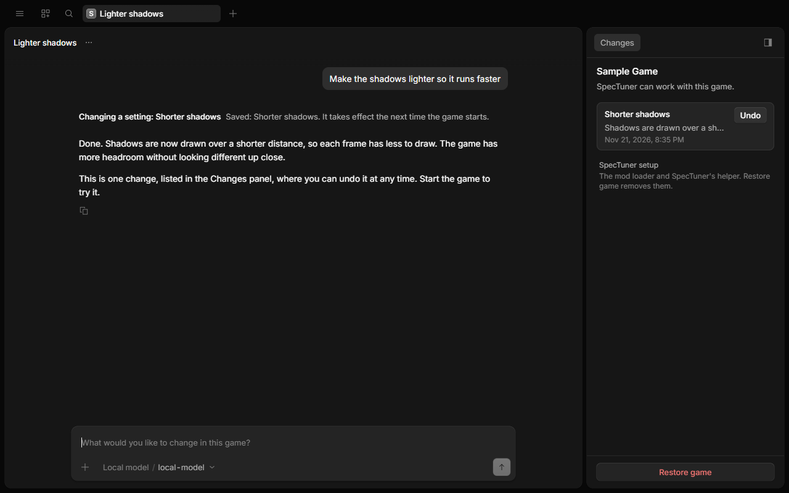
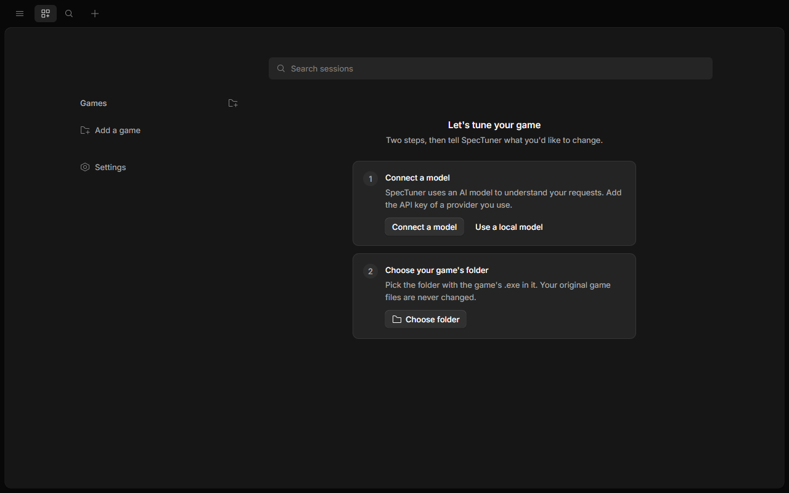
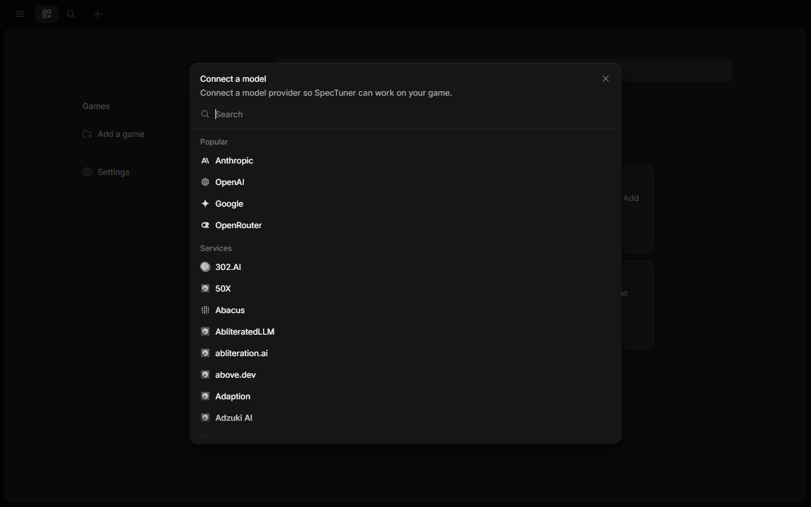
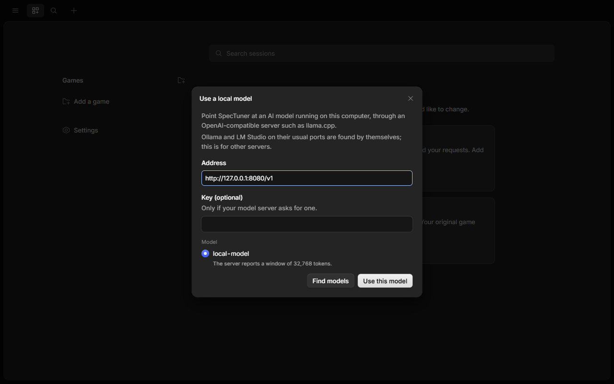
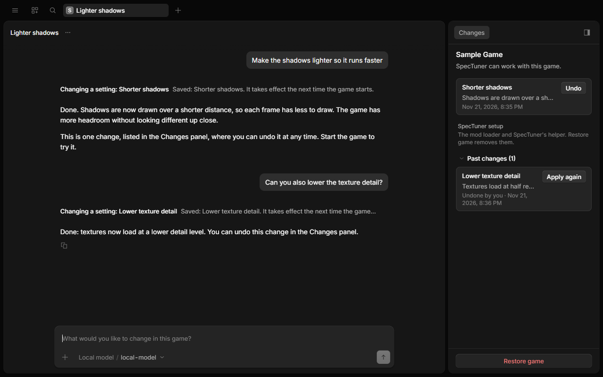
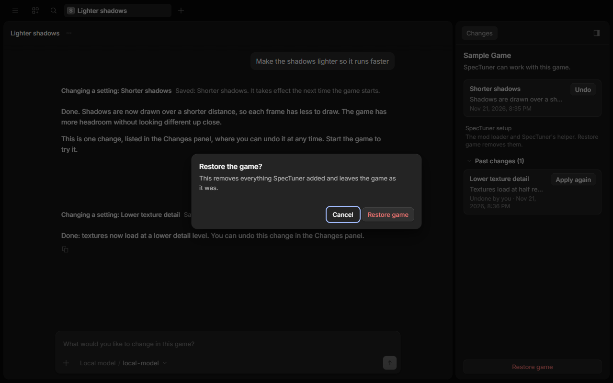

# SpecTuner

SpecTuner is a Windows app that changes Unity games for the people who own
them. You pick a game, connect an AI model, and type what you want, for
example "make this run smoothly on my PC" or "double the jump height". The AI
measures the game, changes its graphics settings or writes a small add-on for
it, and records every change so you can undo it. One button puts the game back
exactly as it was.



## What you need

- **A Windows 10 or Windows 11 PC, 64-bit.**
- **A single-player Unity game that you own.** Unity is the engine many games
  are made with. SpecTuner checks the game first and tells you if it cannot
  work on it, and why. It declines:
  - games with anti-cheat,
  - games whose code is protected or encrypted, including some copy
    protection used by game stores,
  - online multiplayer games,
  - Unity games built in a way called IL2CPP, which SpecTuner cannot read yet,
  - games not made with Unity.
- **An AI model.** This is the part that understands your request and does the
  work. SpecTuner does not include one. You connect one of these two kinds:

| | A model from an AI provider | A model on your own PC |
|---|---|---|
| What it is | You make an account with a company that runs AI models, create a key on their website and paste it into SpecTuner. The key is a long password that lets SpecTuner use your account. | You install a program that runs an AI model on your PC, and point SpecTuner at it. |
| Cost | You pay the provider for what you use. One request can take many steps, so check your provider's prices and limits. | Free. |
| Your PC | Any PC that can run the game. | Needs a strong PC, with plenty of memory and a capable graphics card, and more setup. |
| Your data | Your request and parts of the game's code go to that provider. | Everything stays on your PC. |

Whichever you choose, the model must be able to use tools, a feature most
providers list for each model. Small models running on a PC handle
performance tuning more reliably than gameplay changes. Gameplay changes go
better with a stronger model.

## Download and install

1. Open this repository's **Releases** page and download
   `spectuner-desktop-win-x64.exe`. Your browser may warn that the file is not
   commonly downloaded. Choose to keep it.
2. Double-click the file.
3. Windows may show a blue box that says **Windows protected your PC**. This
   appears because the installer is not code-signed. Signing is a paid
   certificate that tells Windows who published a program, and SpecTuner does
   not have one yet. To continue, click **More info**, then **Run anyway**. If
   you would rather not do this, you can build SpecTuner yourself from the
   source code instead (see "For developers" below).
4. The installer runs without asking questions. It installs SpecTuner for
   your Windows user only.
5. Start **SpecTuner** from the Start menu.

Nothing else needs installing. SpecTuner carries everything it needs.

There are no automatic updates. To update, download the newer installer and
run it. It installs over the old version.

## First start



The first screen, **Let's tune your game**, has two steps.

### Step 1. Connect a model

**If you have a key from an AI provider:**

1. Click **Connect a model**.
2. Pick your provider from the list.
3. Paste your key and confirm.

SpecTuner keeps the key on your PC, in its own data folder.



**If you run a model on your own PC:**

1. Start your model program first.
2. Click **Use a local model**.
3. If you use Ollama or LM Studio on their usual settings, SpecTuner finds
   them by itself. For other programs, type the address your model program
   shows, such as `http://127.0.0.1:8080/v1`. Fill in **Key** only if your
   model program asks for one.
4. Click **Find models**, pick one under **Model**, then click
   **Use this model**.

The form tells you how much text the model can hold at once, called its
window. If it says the window is small, performance tuning may still work,
but gameplay changes may fail. A window of 32,000 tokens or more works better.



You can add or change models later in **Settings**.

### Step 2. Choose your game's folder

Click **Choose folder** and pick the folder that has the game's `.exe` file
in it. A chat for that game opens.

To find the folder of a Steam game:

1. In Steam, right-click the game in your library.
2. Choose **Manage**, then **Browse local files**.
3. The folder that opens is the one to pick.

For other stores, look in the store's settings for the install folder, or
right-click the game's shortcut and choose **Open file location**.

## Asking for changes

Type your request in the box at the bottom of the chat and send it. Close the
game first. SpecTuner will not change a game while it is running.

### Example: "Make this run smoothly on my PC"

1. SpecTuner starts the game and measures how smoothly it runs.
2. It tries graphics settings one at a time, such as shorter shadows or a
   lower rendering resolution. Each one is measured with and without the
   setting, in the same run of the game.
3. It keeps a setting only when the measured gain is clear. Settings that
   make no clear difference are dropped.
4. It measures once more and tells you the result: the frame rate before and
   after, each change it kept, and what that change looks like in the game.
   If nothing helped, it says so.

The game window opens and closes by itself several times while this runs.
That is expected. Leave it alone until SpecTuner has finished.

SpecTuner measures whatever the game shows after it starts, usually a title
screen or menu. Busy moments in play can behave differently.

### Example: "Double the jump height"

1. SpecTuner reads the game's code to find where the jump height is set.
2. It writes a mod. A mod is a small add-on that changes the game while it
   runs.
3. It checks the mod for unsafe code, builds it, and starts the game once to
   confirm the mod loads without errors. The game window opens and closes by
   itself.
4. It tells you what changed and how to try it.

SpecTuner cannot press keys or play the game. For a changed value such as
jump height, it can see in the game's log that the new value was applied. For
a new behaviour, such as "let me fly while I hold the space bar", it can only
confirm that the mod loaded. Try it in the game. If it does not do what you
asked, say so in the same chat and describe what happened. SpecTuner reads
the game's log from your last session and builds a corrected version.

You can also ask in the chat to undo a change or put an earlier one back.

## Undo, past changes and restore

The **Changes** panel next to the chat lists everything SpecTuner has done to
this game.

- **Undo.** Every change has its own **Undo** button. The item named
  **SpecTuner setup** is the mod loader and SpecTuner's helper. A mod loader
  is a small program that lets mods run inside a game. Restore game removes
  them.
- **Past changes.** Changes that were undone, removed by Restore game,
  replaced by a newer version, or removed because they did not work are
  listed under **Past changes**. Click **Apply again** to put one back.
  Applying a mod again starts the game once to check it. Changes that never
  worked cannot be applied again. This list stays after Restore game.
- **Restore game.** Removes everything SpecTuner added and leaves the game as
  it was. SpecTuner asks you to confirm first. It then checks every file
  against the record it took before its first change and tells you if
  anything is different.





## Playing the game

Start the game the way you always do, from Steam, another store, or its
shortcut. Nothing else is needed. The mod loader starts with the game and
applies your changes.

Graphics settings that SpecTuner saved take priority over the game's own
settings menu for those settings. To change one of them in the game's menu
again, undo that change in SpecTuner first.

## Is it safe? What does it do to my game and my data?

**Your game files.**

- SpecTuner never edits, replaces or deletes the game's original files.
- It adds the BepInEx mod loader to the game folder: a folder named `BepInEx`
  and three small files next to the game's `.exe` (`winhttp.dll`,
  `doorstop_config.ini` and `.doorstop_version`). Its helper, saved settings
  and mods all go inside the `BepInEx` folder.
- Before its first change, SpecTuner records every file in the game folder.
  Restore game removes only what SpecTuner added. Files the game wrote itself,
  such as a save file, are left alone and listed.
- If the game already had BepInEx 5 installed, SpecTuner uses it and never
  removes it.

**Mods are code written by an AI.** A mod runs inside your game with the same
access as the game. Before building a mod, SpecTuner refuses code that starts
other programs, uses the internet, the Windows registry or files, or calls
into Windows directly. This check catches common problems, but it is not a
sandbox, meaning a sealed space the code cannot get out of. Only ask for
changes you are comfortable running.

**Games you own, played offline.** SpecTuner is for single-player games you
own. It only detects anti-cheat, DRM, licence checks and encryption so it can
decline the game. It never bypasses, disables or works around them.

**No warranty.** SpecTuner is free software and comes as it is. If a change
breaks something, **Restore game** puts the game back as it was.

**What leaves your PC.**

- With a provider's model, your requests, the replies, parts of the game's
  code, its graphics settings, a short summary of your PC's hardware and
  lines from the game's log go to the provider you chose. Their privacy terms
  apply.
- With a model on your own PC, all of that stays on your PC.
- SpecTuner also downloads a public list of AI models and providers, so it
  can show them when you connect one.

**Where SpecTuner keeps its own data.** In two folders under your Windows
user: `%LOCALAPPDATA%\SpecTuner` and `%APPDATA%\com.spectuner.desktop`. These
hold your chats, settings, connected models, and the records SpecTuner needs
to undo and restore changes. Nothing of SpecTuner's own is kept in the game
folder except what Restore game removes.

## If something goes wrong

- **SpecTuner says the game is not supported.** The message says why. Nothing
  was changed. SpecTuner cannot work on that game, and there is no setting to
  get around it.
- **SpecTuner says the game already has a different mod loader.** It will not
  install its own on top of another one. Nothing was changed.
- **SpecTuner says it cannot change the game while it is running.** Close the
  game and send your request again.
- **The model does nothing, gets stuck, or repeats itself.** The model you
  connected may not be able to use tools, or may be too small for the
  request. Try a different model. With a model on your PC, choose one with a
  larger window.
- **A change does nothing in the game.** Say so in the same chat and describe
  what you did and what happened. SpecTuner reads the game's log and tries
  again. You can also click **Undo** on the change.
- **The game stops starting after a change.** When SpecTuner starts the game
  and it fails, SpecTuner undoes every change made since the game last
  started properly, and tells you in the chat. If it fails when you start it
  yourself, click **Undo** on the latest change, or use **Restore game**.
- **You want to remove everything.**
  1. In SpecTuner, click **Restore game** for each game you changed.
  2. Uninstall SpecTuner from Windows **Settings**, under **Apps**.
  3. To remove SpecTuner's own data too, delete the two folders listed above.
     Type each one into the address bar of File Explorer to open it.
- **Something called SpecTuner is still running after you close the window.**
  This is a small background helper the app uses. It accepts connections only
  from your own PC and is protected by a password. It stops when you sign out
  or restart your PC.

## Limits

- Windows only. Built and tested on Windows 11.
- Unity games built the usual way, called Mono, only. IL2CPP games are
  declined for now.
- Tested on very few games so far. Expect some games not to work.
- English only.
- There is no support channel yet.

## For developers

[CLAUDE.md](CLAUDE.md) explains how the project is put together and how to
work on it. It is written for people and for AI coding agents.
[docs/design-decisions.md](docs/design-decisions.md) explains why things work
the way they do. [docs/sidecar-contract.md](docs/sidecar-contract.md)
describes the helper program that does the work on the game folder.
[THIRD_PARTY_NOTICES.md](THIRD_PARTY_NOTICES.md) lists the bundled components
and their licences.

To build from source you need [Git](https://git-scm.com), [Bun](https://bun.sh)
and the [.NET 10 SDK](https://dotnet.microsoft.com/download). In Git Bash,
from the repository folder:

```
cd app && bun install && cd ..
./build.sh --installer
```

The last line printed is the path of the packaged app. With `--installer`,
the Windows installer is built as well.

## Credits and licence

SpecTuner's app code started from [opencode](https://github.com/anomalyco/opencode)
2.3.0, which is MIT licensed, and is now developed independently. SpecTuner
installs the [BepInEx](https://github.com/BepInEx/BepInEx) mod loader into
games. Licence texts are in [LICENSE](LICENSE), [app/LICENSE](app/LICENSE),
[licenses/](licenses/) and [THIRD_PARTY_NOTICES.md](THIRD_PARTY_NOTICES.md).
